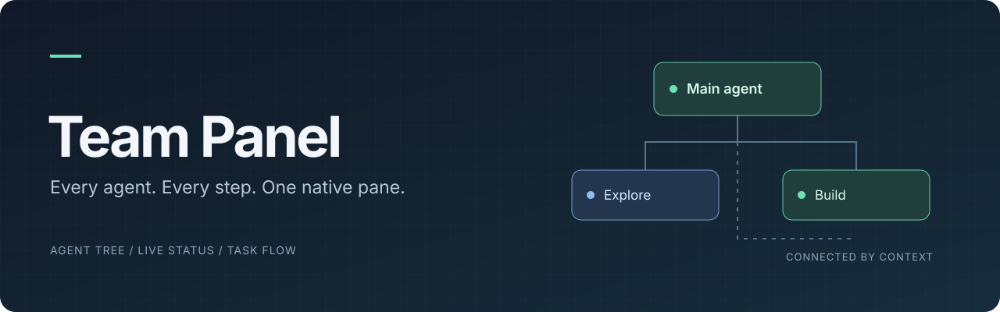
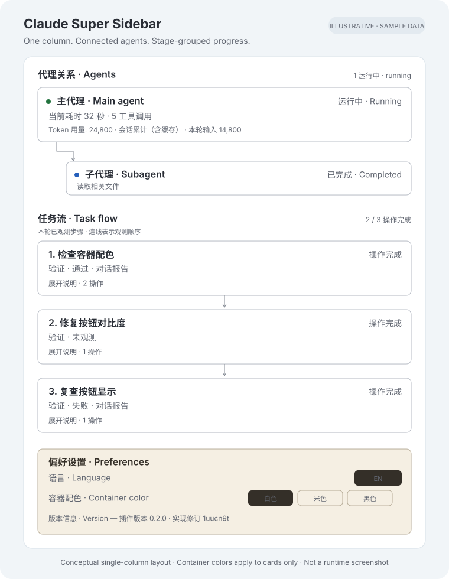

<p align="center">
  
</p>

<p align="center">
  <strong>See your agents. Follow the work.</strong><br />
  A native Claude pane and a local Codex session panel.
</p>

<p align="center">
  <a href="LICENSE"></a>
  
  
  
  
</p>

<p align="center">
  <strong>English</strong> · <a href="README.zh-CN.md">简体中文</a>
</p>

<p align="center">
  <a href="#preview">Preview</a> ·
  <a href="#installation">Installation</a> ·
  <a href="#usage">Usage</a> ·
  <a href="#codex-configuration">Codex</a> ·
  <a href="#development">Development</a> ·
  <a href="#audit-and-validation">Validation</a>
</p>

## Overview

Team Panel brings the main agent, subagent relationships, execution details, and the current conversation’s work steps into one panel. Claude Code uses a native plugin pane; standalone Codex CLI/App uses a read-only local session dashboard. Neither requires a frontend build.

The Claude plugin ID is `team-panel`, with a native pane titled **状态 · Status**. The Codex page is titled **状态 status**, and its team section is **团队面板 Team panel**. Each adapter uses its host's own data source; task summaries require no additional model call.

| Integration | Data source and UI | Current validation |
| --- | --- | --- |
| Claude Desktop Code | Lifecycle hooks and `session.messages()` → native pane | Historical portable checks passed; latest isolation regressions have not been run; current native engine validation and Desktop reload remain unverified |
| Codex CLI / App | Local `sessions/rollout-*.jsonl` → read-only browser panel | Historical adapter/HTTP checks passed; latest isolation regressions have not been run; real local App session and page verified |

## Preview

<p align="center">
  
</p>

Illustrative layout with sample data, not a runtime screenshot. Each conversation has its own agents, activity, and current-request task flow. Actual rendering differs between the Claude native pane and Codex browser panel.

## Features

- **Agent relationships** — main agent and subagents in a unified tree, with directional connectors and details that expand in place.
- **Execution status** — colored running, waiting, completed, and failed states. Claude shows active elapsed time; Codex shows recorded time without inferring process liveness.
- **Agent details** — model, mode, role, observed token usage, available context usage, elapsed time, and tool-call count.
- **Conversation task flow** — Claude uses tool operation titles with progress explanations. Codex derives titles and summaries from public progress messages, groups consecutive calls within one stage, and waits for all results before completion while preserving failures.
- **Per-request scope** — each new user request clears the previous flow; tool results preserve the current round. Up to 30 recent steps are shown.
- **Plan display** — Claude extracts observable plan text. Codex displays successfully submitted `update_plan` steps; failed updates preserve the previous plan.
- **Local parsing** — deriving the flow requires no additional LLM call.

## Requirements

The following requirements apply to the Claude plugin. The Codex dashboard only requires Node.js 22.18+ and locally persisted Codex sessions.

- A Claude Desktop Code host that exposes the native hook-module and pane APIs.
- The matching Claude Code CLI for plugin installation.
- A stable local copy of this repository.

Developed against **Claude Code engine 2.1.299**, using an early-access plugin API. The host must support hook modules, `claude-code` imports, and native `ui.render` panes. Availability may differ between distributions and versions.

## Installation

### Claude Desktop Code

Download or clone the repository, then run this from its root:

```bash
claude plugin install team-panel --marketplace . --scope user
```

Verify that `team-panel@team-panel-local` has scope `user` and `enabled: true`:

```bash
claude plugin list --json
```

If it is installed but disabled:

```bash
claude plugin enable team-panel@team-panel-local
```

Start a new Code session to load the plugin. User scope makes it available across projects for the current user. Keep the repository at its installation location: the verified local installation reads from the source folder.

If `claude` is not on `PATH`, invoke your host’s matching Claude Code executable by its full path. Project overrides and organization policies may affect plugin loading.

## Usage

These controls apply to the Claude native plugin. See [Codex configuration](#codex-configuration) for the local dashboard and conversation binding.

The plugin attempts to open **状态 · Status** on session startup. Type `/team-panel` in the conversation input to reopen it.

| Section | What it shows |
| --- | --- |
| Team Panel | Main agent, subagents, parent–child connections, and expandable execution details |
| Task Flow | Work steps observed in the current request, with status and explanations |

Use **展开 / 收起** to expand or collapse an agent. Use **刷新** to refresh immediately; the pane also refreshes every two seconds.

Task-flow arrows indicate chronological execution. A new user request starts a fresh flow automatically, without task-management controls.

## Codex configuration

### Codex model in a Claude host

If your Claude Desktop deployment offers a Codex model, follow the Claude installation above and select that model in the host’s model picker. No Codex-specific configuration file is required: the Claude host supplies session events and the native pane API.

Team Panel does not add models or configure model providers.

### Standalone Codex CLI or App

The **read-only local session dashboard** supports standalone Codex. From this repository:

```bash
npm run codex -- --cwd "/absolute/path/to/your/project"
```

Open the [local panel](http://127.0.0.1:4317), or ask Codex App to open that URL in its browser sidebar. No `npm install`, API key, or Codex configuration changes are required. Without `--cwd`, the panel observes the process working directory.

```bash
node codex/server.mjs --cwd "/path/to/project" --port 4318 --codex-home "/path/to/codex/data"
```

The panel incrementally reads local JSONL files under `CODEX_HOME/sessions` (default `~/.codex/sessions`) every two seconds. Each panel stays bound to one conversation and its descendants, showing the latest turn's 30 most recent work steps, successfully submitted plan, and observed usage. Summaries come from public progress messages; wrapper names such as `exec` / `js` are hidden, with human-readable operation titles as fallbacks. The session picker, project path, task-flow explanation and refresh-mechanism footer are omitted. Stop with `Ctrl+C`.

Starting from Codex uses `CODEX_THREAD_ID` automatically. Alternatively pass `--thread "full-thread-id"` or open `http://127.0.0.1:4317/?thread=full-thread-id`. Without a binding, the panel initially pins the most recent local conversation and never switches as other conversations change.

```bash
npm run codex -- --cwd "/absolute/path/to/project" --thread "full-thread-id"
```

When the server is already running, open another conversation with its own `?thread=...` URL. The URL binding overrides the server default; all conversations remain limited to the project path chosen at server startup.

This is a companion browser UI, not a Claude `ui.render` plugin inside Codex, and it does not drive conversations. The local rollout format is not a stable public API. Compatibility was checked with **Codex CLI 0.162.1 and this machine's App session records**. Ephemeral, remote, archived, and unpersisted sessions are excluded; abnormal exits can leave the last observed state. See [Codex adapter details](codex/README.md).

## How it works

```text
Claude Code session
  ├─ Agent / turn / tool events ──→ Agent status and usage
  └─ Conversation transcript ─────→ Current-request work steps
                                      │
                              Session-scoped state
                                      │
                            Native Status pane
                            ├─ Team Panel
                            └─ Task Flow
```

The manifest loads `hooks/register.tsx` through `hooks/hooks.json`. Session startup registers the command and refresh timer; lifecycle hooks observe execution; `session.messages()` supplies the task-flow parser. Native components and SVG connectors render the pane.

## Development

For a compatible interactive CLI, load the repository explicitly:

```bash
claude --plugin-dir .
```

For Desktop hot reload, invoke the bundled `/plugin-authoring` skill and accept the host’s hot-reload prompt. Edits reload **at the end of the turn**.

Validate the manifest and hook modules with the matching CLI:

```bash
claude plugin validate .
```

| Path | Responsibility |
| --- | --- |
| [.claude-plugin/](.claude-plugin/) | Plugin manifest and local marketplace |
| [hooks/register.tsx](hooks/register.tsx) | Lifecycle hooks, command, and refresh |
| [hooks/pane.tsx](hooks/pane.tsx) | Native pane and connectors |
| [hooks/steps.ts](hooks/steps.ts) | Conversation-to-flow parser |
| [hooks/model.ts](hooks/model.ts) | State and agent-tree helpers |
| [types/index.d.ts](types/index.d.ts) | Plugin state contract |
| [codex/](codex/) | Read-only Codex adapter, local server, browser UI and tests |
| [verification/](verification/) | Historical captures and inspection notes |

## Audit and validation

Historical check before the latest isolation fixes: `npm test` **32 passed, 0 failed**. The current isolation audit added regression cases without running tests/builds; see [current audit](docs/AUDIT-2026-10-20-isolation.md). Reproduce without installing packages:

```bash
npm run test:claude  # 9 tests: actual model/parser sources, mocked lifecycle host
npm run test:codex   # 23 tests: parsing, incremental reads, scope, HTTP/CLI
npm test            # All portable tests
```

This audit fixed premature activity clearing during overlapping Claude tools, stale native pane test labels, and a Codex project-scope bypass after a rollout file replacement. See the [audit report](docs/AUDIT-2026-10-20.md) and [verification evidence](verification/2026-10-20-codex/README.md).

Codex has real local session and browser evidence. Claude's portable logic regressions pass, but no runnable compatible Claude Code CLI was found for this audit: **native `claude plugin validate`, `claude plugin test`, and Desktop loading were not rerun**. The covered checks pass; this does not establish error-free behavior across both hosts and all versions. Historical installation results and screenshots do not replace current native-host validation.

## Limitations

- Claude plan extraction has logic regression coverage but remains unverified in the current native pane. Codex plan updates have success/failure result coverage.
- Main-agent context usage comes from the host. Unavailable subagent metrics are shown as unavailable; token totals reflect observed completed turns, including cache tokens.
- Steps reflect the available transcript and progress-message grouping, rather than a dependency graph or task scheduler.
- Claude installation and enablement have historical evidence only; the current code still requires validation, loading, and fresh-session auto-opening checks in a compatible host.
- The Claude plugin does not aggregate cross-session history. Codex resolves explicitly bound conversations and descendants before the recent-session cap; unbound discovery is limited to 100 sessions; the API returns only that conversation and its descendants. Missing records show a waiting state without falling back to another conversation. Terminal fallbacks do not reproduce the native visual pane.
- Codex usage reflects recorded cumulative tokens and the last request's input tokens. Last input size is not live context occupancy. Unknown fields are ignored; malformed lines are skipped with a notice.

The Codex rollout format is not a stable public API; compatibility is limited to tested local versions. This panel does not provide multi-user authentication or remote monitoring.

## Contributing

Issues and pull requests are welcome. For rendering problems, include the host and engine version, reproduction steps, and a screenshot with sensitive information removed. Keep native UI behavior and transcript-derived status changes within the host API contract.

## License

Licensed under the [Apache License 2.0](LICENSE).

---

Created by [Zafer_Liu](https://www.zaferliu.me).
